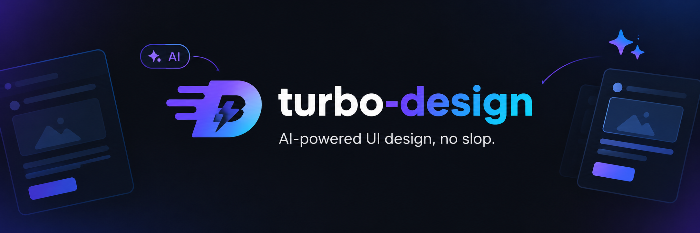

<p align="center">
  
</p>

<p align="center">
  <a href="LICENSE"></a>
  
  
</p>

# turbo-design

turbo-design is a skill for coding agents. It helps them build web interfaces that don't look generated, and it checks the result in a real browser before the agent is allowed to call the job done.

You've probably seen the page I'm talking about. Ask an agent for a landing page and you get a cream background, a rust-coloured button, one italic word in the headline, a tiny uppercase label over every heading, steps numbered 01 to 04, three icon cards in a row and thin dividers everywhere. Nothing is broken. Nobody decided any of it, either.

This skill makes the agent take its decisions from the subject it's designing for, and then measures the page to check that the old defaults haven't crept back in.

## How it works

The agent follows the same sequence every time:

1. It starts from what's real. Before designing anything it lists 8 to 12 things that belong to this client and no competitor: the name, the place, the numbers, the constraints, the printed stuff of that world. It also looks at how the best products in the category handle their first screen.
2. It writes the argument and the copy before any markup. Every section has to prove a claim. Numbers, quotes and logos come from the brief, and if the brief doesn't have them, they don't appear.
3. It picks a direction. The agent writes three directions in words, and at least one is dealt at random from a research library (20 art directions, 48 hero layouts, 172 section blueprints), so it can't fall back on its favourite look. Each one has to pass a difference test and a competitor test: would this idea still work for the shop down the road? A project log keeps two builds from ending up with the same fingerprint.
4. It builds the static page: tokens first, then the first screen, then one section at a time. Pictures are real ones (the client's, generated, or openly licensed archive images with credits). Grey placeholder boxes aren't allowed.
5. A linter scans the source, and an inspector renders the page in Chrome or Edge and measures it.
6. Motion goes in next, and the checks run again.
7. A fresh subagent that has never seen the code reviews screenshots only. It lists everything that still looks generated and scores the page against a fixed rubric, for up to three rounds.
8. Finally the agent cuts what isn't needed and writes a report, which includes every check it didn't run.

## What the checks catch

The inspector renders pages at 1440, 768, 390 and 320 px. It scrolls through one screen at a time, tabs through every control, then reloads with JavaScript off and again with reduced motion. There are around 70 rules, in three tiers:

| Tier | What it means | Examples |
| --- | --- | --- |
| Hard ban | Never ships, no override | cream with terracotta, violet accents, gradient text, a styled accent word in a headline, labels above headings, rows of icon cards, nested cards, placeholder text or boxes, content that never appears, invisible keyboard focus, horizontal overflow |
| Licensed | Banned by default, allowed (three at most) when the subject really owns it and the reason is written down | thin rules for a timetable, monospace for a developer tool, numbering for a real sequence |
| Warning | Usually wrong, needs a one-line justification | centred hero stack, the same 12 px radius on everything, more than eight type sizes, stock phrases |

Product screens have their own rules on top: rainbow status pills, initials avatars in candy colours, rows of KPI cards with green and red deltas.

## Requirements

- A coding agent that supports skills: Claude Code, or any agent that reads a `SKILL.md` folder
- Node.js 22 or later
- Chrome, Edge or Chromium (set `CHROME_PATH` if yours is somewhere unusual)
- Network access for web fonts and image search, if you want them

There's nothing to `npm install`. The scripts only use the Node standard library.

## Installation

Clone the repo:

```bash
git clone https://github.com/Fasertio/turbo-design.git
```

Then copy the skill folder into your agent's skills directory. For Claude Code, a personal skill works in every project:

```bash
# macOS / Linux
cp -r turbo-design/skills/turbo-design ~/.claude/skills/

# Windows (PowerShell)
Copy-Item -Recurse turbo-design\skills\turbo-design $HOME\.claude\skills\
```

If you only want it in one project, copy it to `.claude/skills/turbo-design` inside that project instead.

Restart the agent so it picks up the skill. If you have other design skills installed, turn them off while you use this one, because overlapping instructions give mixed results.

To check that the tools run on your machine:

```bash
node ~/.claude/skills/turbo-design/tests/run.mjs
```

Everything should pass. The test renders a deliberately bad page, which has to be rejected, and a clean one, which has to pass.

## Usage

You don't have to call the skill by name. Ask for interface work and the agent loads it on its own:

```text
Build a one-page site for a rope workshop in Genoa. The main action is ordering a coil.
Redesign the pricing page in src/pages/pricing.tsx, keep the copy and the routes.
Audit this landing page and tell me why it looks AI-made. Do not change anything.
Build the order queue screen for our warehouse dashboard.
```

In an interactive session the agent proposes three directions and waits for you to choose. Say "just build it" and it picks one itself, tells you which and why, and carries on.

At the end you get the chosen direction and the idea behind it, the inspector result, the review scores, and a list of anything it couldn't verify.

### Surfaces

| Profile | For | What changes |
| --- | --- | --- |
| `page` | Landing pages, brand sites, portfolios, event pages | Real pictures, a dominant first screen and a motion layer are required |
| `app` | Dashboards, admin screens, tools, tables, forms | Workspace-first layout with density, status and data rules; no picture or motion quotas |
| `component` | A single button, input, card or modal | Every interaction state rendered on one preview page |

### Running the tools yourself

The scripts work fine without the agent, for example to audit a page you already have:

```bash
SKILL=~/.claude/skills/turbo-design

node $SKILL/scripts/lint.mjs src/                         # scan source files
node $SKILL/scripts/inspect.mjs index.html                # full browser inspection
node $SKILL/scripts/inspect.mjs http://localhost:3000 --profile app
node $SKILL/scripts/inspect.mjs index.html --quick        # one screen per width, for fast iteration
node $SKILL/scripts/deal.mjs --sector restaurant --brief "a 30-seat fish restaurant" --options 3
node $SKILL/scripts/assets.mjs "genoa harbour 1920"       # openly licensed pictures, with credits
```

Output lands in `.turbo/` in the current directory: screenshots at every width, a review kit (480 px thumbnails plus versions with the text masked) and a `report.json`. The exit code is 0 when nothing failed and 1 when at least one rule did.

A project can keep its decisions in `.turbo/direction.json`: the surface profile, licensed devices and the reasons for them, brand-owned colours and the facts the brief confirmed. The format is described in `skills/turbo-design/references/tools.md`.

## Repository layout

```
skills/turbo-design/
  SKILL.md         the workflow the agent follows
  references/      rules and reference material, loaded only when a step needs them
  scripts/         lint, inspect, deal and assets, plus their shared libraries
  library/         the research library used by deal.mjs
  assets/          an optional neutral CSS and JS starting point
  tests/           self-test with a failing and a passing fixture
```

## Limitations

- The checks look for what generated pages have in common. Passing them doesn't make a page good. That's what the isolated review is for, and the review is still a model looking at screenshots.
- A full run is slow: several inspector passes and up to three review rounds. Use `--quick` while you iterate.
- Fonts and images need network access. Offline, fonts fall back and the screenshots won't match the design.
- The review step needs an agent that can start subagents. Without that, the agent reviews its own work and says so in the report.

## License

MIT, see [LICENSE](LICENSE).
